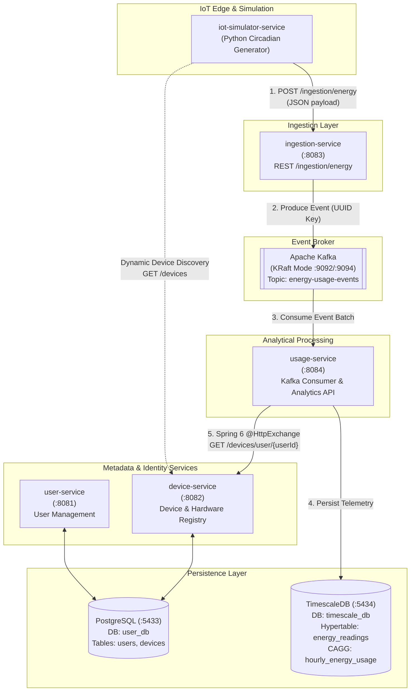

# ⚡ IoT Energy Tracker (`iotEnergyTracker`)

An enterprise-grade, event-driven microservices platform engineered for real-time Internet of Things (IoT) smart meter telemetry ingestion, high-throughput streaming, time-series storage, and analytical rollups.

---

## 📑 Table of Contents

1. [Overview & Core Objectives](#-overview--core-objectives)
2. [System Architecture & Design Patterns](#-system-architecture--design-patterns)
3. [Technology Stack](#-technology-stack)
4. [Microservices Breakdown](#-microservices-breakdown)
   - [User Service (`user-service`)](#1-user-service-port-8081)
   - [Device Service (`device-service`)](#2-device-service-port-8082)
   - [Ingestion Service (`ingestion-service`)](#3-ingestion-service-port-8083)
   - [Usage & Analytics Service (`usage-service`)](#4-usage-service-port-8084)
   - [IoT Simulator Service (`iot-simulator-service`)](#5-iot-simulator-service-python)
5. [Data Architecture & Storage](#-data-architecture--storage)
   - [Relational Storage (PostgreSQL)](#relational-storage-postgresql-user_db)
   - [Time-Series Storage (TimescaleDB)](#time-series-storage-timescaledb-timescale_db)
   - [Uniform UUID Identifier Standard](#uniform-uuid-identifier-standard)
6. [API Specification & Endpoints](#-api-specification--endpoints)
7. [Getting Started & Local Development](#-getting-started--local-development)
8. [Docker Compose & Infrastructure Setup](#-docker-compose--infrastructure-setup)
9. [Verification & Health Checks](#-verification--health-checks)

---

## 🎯 Overview & Core Objectives

Modern smart electrical grids and home automation systems produce massive streams of high-frequency sensor readings (smart meters, solar monitors, thermostats, heat pumps). Managing this telemetry requires a decoupled architecture capable of:

- **High-Throughput Ingestion**: Ingesting high-velocity readings asynchronously without blocking client clients or database connections.
- **Resilient Message Streaming**: Buffering events using Apache Kafka to prevent downstream database saturation during load spikes.
- **Specialized Time-Series Persistence**: Partitioning time-series telemetry automatically into hypertable chunks and calculating rolling aggregates.
- **Relational Domain Management**: Tracking users, their registered smart devices, and alerting thresholds.
- **Unified Aggregated Analytics**: Asynchronously or declaratively pulling together device metadata and telemetry rollups to serve client dashboards.

---

## 🏗️ System Architecture & Design Patterns

The platform implements an **Event-Driven Microservice Architecture (EDA)** adhering to the **Database-per-Service** pattern:



### Key Architectural Patterns
1. **Event-Driven Architecture (EDA)**: Producers (`ingestion-service`) and consumers (`usage-service`) are completely decoupled via Apache Kafka.
2. **Database-per-Service & Polyglot Persistence**:
   - Transactional relational data (users, device metadata) lives in **PostgreSQL**.
   - Massive-volume append-only time-series data lives in **TimescaleDB**.
3. **Declarative HTTP Interfaces (Spring 6 `@HttpExchange`)**: `usage-service` delegates device resolution directly to `device-service` through compile-safe declarative HTTP interfaces rather than raw RestTemplate calls.
4. **Time-Series Continuous Aggregates**: TimescaleDB materialized continuous aggregates automatically pre-compute hourly statistics in the background, keeping dashboard queries constant-time.
5. **Standardized Identity Model**: All entity IDs (users, devices, meters) are strictly formatted as RFC-4122 `UUID`s across database columns, Kafka keys, DTOs, and REST path variables.

---

## 💻 Technology Stack

### Backend & Frameworks
- **Java 17**: LTS enterprise Java baseline.
- **Spring Boot 4.x / 3.x**: Microservice core runtime.
- **Spring Data JPA & Hibernate**: ORM for entity-relational mapping.
- **Spring Kafka**: Enterprise messaging and stream integration.
- **Spring WebMVC & HTTP Interfaces**: REST controllers and declarative `@HttpExchange` client proxies.
- **Flyway**: Versioned, reproducible database schema migrations.
- **Lombok**: Boilerplate reduction for entities and DTOs.
- **AspectJ / Spring AOP**: Cross-cutting controller execution-time logging.

### Streaming & Databases
- **Apache Kafka (KRaft mode)**: High-performance distributed commit log without ZooKeeper overhead.
- **PostgreSQL 16**: Primary relational storage for user identity and device catalogs.
- **TimescaleDB (PostgreSQL 16 extension)**: Hypertable partitioning, continuous aggregate rollups, and automated compression.

### IoT Simulation
- **Python 3.12**: Lightweight IoT telemetry simulator with Gaussian noise, circadian diurnal cycles, and dynamic HTTP device discovery.

### DevOps & Infrastructure
- **Docker & Docker Compose**: Multi-container container orchestration with build-caching, healthchecks, and development bind mounts.

---

## 📦 Microservices Breakdown

### 1. User Service (Port: `8081`)
- **Directory**: `user-service/`
- **Purpose**: Manages system users, authentication profiles, addresses, and alerting thresholds.
- **Database**: PostgreSQL (`user_db`), managed via Flyway (`V1__init_user_schema.sql`, `V2__change_user_id_to_uuid.sql`).
- **Key Files**:
  - Entity: `org.userservice.userservice.entity.User`
  - Controller: `org.userservice.userservice.controller.userController`
  - Repository: `org.userservice.userservice.repository.userRepository`
- **Endpoints**:
  - `POST /users`: Create new user.
  - `GET /users`: List all users.
  - `GET /users/{id}`: Fetch user by `UUID`.
  - `PUT /users/{id}`: Update user profile or threshold.
  - `DELETE /users/{id}`: Delete user (cascades to devices).

---

### 2. Device Service (Port: `8082`)
- **Directory**: `device-service/`
- **Purpose**: Manages IoT devices, categories, installation locations, and their ownership mapping to users.
- **Database**: PostgreSQL (`user_db`), table `devices`.
- **Supported Device Types**:
  - `SMART_METER`: Primary grid electric meter.
  - `THERMOSTAT`: Smart HVAC thermostat.
  - `APPLIANCE`: Heavy consumer (EV charger, AC unit, heat pump).
  - `SENSOR`: Current clamp, sub-panel monitor.
  - `ACTUATOR`: Smart relay / switch.
- **Endpoints**:
  - `POST /devices`: Register a new device.
  - `GET /devices`: List all registered devices.
  - `GET /devices/{id}`: Find device by its `UUID`.
  - `GET /devices/user/{userId}`: Fetch all devices owned by a given user `UUID`.
  - `PUT /devices/{id}`: Update device details.
  - `DELETE /devices/{id}`: Delete device.

---

### 3. Ingestion Service (Port: `8083`)
- **Directory**: `ingestion-service/`
- **Purpose**: High-throughput gateway entrypoint for IoT devices and smart meters.
- **Core Functionality**:
  - Receives JSON telemetry payloads.
  - Publishes events asynchronously to Kafka topic `energy-usage-events`.
  - Partitions messages across Kafka partitions using the meter's `UUID` as message key (guaranteeing in-order delivery per meter).
  - Returns `202 ACCEPTED` immediately without waiting for database operations.
- **Endpoints**:
  - `POST /ingestion/energy`: Ingest a single energy reading.

---

### 4. Usage Service (Port: `8084`)
- **Directory**: `usage-service/`
- **Purpose**: Telemetry consumption, time-series storage, analytical processing, and client aggregations.
- **Database**: TimescaleDB (`timescale_db`), hypertable `energy_readings`.
- **Core Features**:
  1. **Kafka Telemetry Consumer**: Automatically consumes incoming readings and stores them into the TimescaleDB hypertable.
  2. **Raw Telemetry History**: Supports bounded queries with time window (`start` and `end` timestamps) or recent reading limits.
  3. **Continuous Aggregate Stats**: Queries TimescaleDB pre-aggregated materialized views for instant hourly calculations (`avgUsage`, `peakUsage`, `minUsage`, `totalReadings`).
  4. **Multi-Device User Aggregator**: Integrates with `device-service` via Spring 6 `@HttpExchange` (`DeviceClient`), resolves all meters belonging to a user, queries TimescaleDB for each device, and outputs a complete user energy dashboard payload.
- **Endpoints**:
  - `GET /usage/{meterId}/history`: Raw telemetry history for a meter.
  - `GET /usage/{meterId}/hourly`: Pre-computed hourly rollups for a meter.
  - `GET /usage/users/{userId}`: Consolidated multi-device energy profile for a user.

---

### 5. IoT Simulator Service (Python)
- **Directory**: `iot-simulator-service/`
- **Purpose**: Synthetic telemetry generator replicating realistic consumer energy behavior.
- **Simulation Models**:
  - **Diurnal Load Curve**: Circadian patterns modeling morning spikes (~07:30) and evening spikes (~19:30).
  - **Random Noise**: Gaussian micro-variations ($\pm 10\%$).
  - **Appliance Spikes**: $3\%$ probability of high-draw appliances (HVAC, EV charger) activating (+3.0 to +8.0 kWh).
  - **Dynamic Discovery**: Can automatically call `GET http://device-service:8082/devices` to simulate registered devices, falling back to deterministic RFC-4122 UUIDs if offline.
- **Run Modes**:
  - `stream`: Periodic transmission per meter (default interval: 3.0s).
  - `burst`: Rapid batch load generator for stress-testing Kafka and ingestion.

---

## 🗄️ Data Architecture & Storage

### Relational Storage (PostgreSQL: `user_db`)
- Managed by `user-service` and `device-service`.
- **`users` Table**:
  - `id`: `UUID` (Primary Key, `gen_random_uuid()`).
  - `username`, `email`, `address`, `alerting`, `energy_alerting_threshold`.
- **`devices` Table**:
  - `id`: `UUID` (Primary Key, `gen_random_uuid()`).
  - `name`, `type` (Enum `DeviceType`), `location`.
  - `user_id`: `UUID` (Foreign Key referencing `users(id)` ON DELETE CASCADE).

### Time-Series Storage (TimescaleDB: `timescale_db`)
- Managed by `usage-service` via Flyway.
- **`energy_readings` Table (Hypertable)**:
  ```sql
  CREATE TABLE energy_readings (
      time         TIMESTAMPTZ      NOT NULL,
      meter_id     UUID             NOT NULL,
      energy_usage DOUBLE PRECISION NOT NULL,
      CONSTRAINT pk_energy_readings PRIMARY KEY (meter_id, time)
  );
  ```
  - Partitioned across 1-day chunks: `chunk_time_interval => INTERVAL '1 day'`.
  - Index: `idx_energy_readings_meter_time` on `(meter_id, time DESC)`.
  - Columnar Compression: Segmented by `meter_id` with chunks older than 7 days automatically compressed.
- **`hourly_energy_usage` (Continuous Aggregate View)**:
  ```sql
  CREATE MATERIALIZED VIEW hourly_energy_usage
  WITH (timescaledb.continuous) AS
  SELECT 
      time_bucket('1 hour', time) AS bucket,
      meter_id,
      AVG(energy_usage) AS avg_usage,
      MAX(energy_usage) AS peak_usage,
      MIN(energy_usage) AS min_usage,
      COUNT(*)          AS total_readings
  FROM energy_readings
  GROUP BY bucket, meter_id;
  ```
  - Auto-refreshed every 15 minutes by TimescaleDB background workers.

### Uniform UUID Identifier Standard
All layers of the platform use canonical 36-character `UUID` strings (RFC-4122):
- Database columns (`UUID`)
- Spring Data Repositories (`UUID`)
- Kafka message keys (`UUIDSerializer` / `UUIDDeserializer`)
- REST Controller `@PathVariable UUID`

---

## 📡 API Specification & Endpoints

### 1. Ingestion Endpoint
#### Ingest Single Reading
```http
POST http://localhost:8083/ingestion/energy
Content-Type: application/json

{
  "meterId": "10000000-0000-0000-0000-000000000001",
  "timestamp": "2026-11-13T19:00:00Z",
  "energyUsage": 4.85
}
```
**Response (`202 ACCEPTED`)**:
```json
{
  "status": "ACCEPTED",
  "message": "Energy usage event queued for publishing",
  "meterId": "10000000-0000-0000-0000-000000000001"
}
```

---

### 2. Usage & Analytics Endpoints

#### Recent Telemetry History for a Meter
```http
GET http://localhost:8084/usage/10000000-0000-0000-0000-000000000001/history?limit=3
```
**Response (`200 OK`)**:
```json
[
  {
    "meterId": "10000000-0000-0000-0000-000000000001",
    "timestamp": "2026-11-13T19:00:00Z",
    "energyUsage": 4.85
  },
  {
    "meterId": "10000000-0000-0000-0000-000000000001",
    "timestamp": "2026-11-13T18:59:57Z",
    "energyUsage": 4.12
  }
]
```

#### Hourly Continuous Aggregate Rollups
```http
GET http://localhost:8084/usage/10000000-0000-0000-0000-000000000001/hourly
```
**Response (`200 OK`)**:
```json
[
  {
    "bucket": "2026-11-13T18:00:00Z",
    "meterId": "10000000-0000-0000-0000-000000000001",
    "avgUsage": 4.21,
    "peakUsage": 8.92,
    "minUsage": 1.45,
    "totalReadings": 1200
  }
]
```

#### Full Multi-Device Usage for a User
```http
GET http://localhost:8084/usage/users/a1111111-1111-1111-1111-111111111111?limitPerDevice=10
```
**Response (`200 OK`)**:
```json
{
  "userId": "a1111111-1111-1111-1111-111111111111",
  "totalDevices": 4,
  "devices": [
    {
      "deviceId": "10000000-0000-0000-0000-000000000001",
      "deviceName": "Main Grid Smart Meter",
      "deviceType": "SMART_METER",
      "location": "Basement Utility Room",
      "recentReadings": [ ... ],
      "hourlyStats": [ ... ]
    },
    {
      "deviceId": "10000000-0000-0000-0000-000000000002",
      "deviceName": "Living Room Smart Thermostat",
      "deviceType": "THERMOSTAT",
      "location": "Ground Floor Living Room",
      "recentReadings": [ ... ],
      "hourlyStats": [ ... ]
    }
  ]
}
```

---

## 🚀 Getting Started & Local Development

### Prerequisites
- **Docker** and **Docker Compose**
- **Java 17+** (OpenJDK or Eclipse Temurin)
- **Maven 3.9+** (or using `./mvnw` wrappers)
- **Python 3.10+** (for optional local simulation)
- **curl** or **Postman / Insomnia**

---

### Starting the Platform with Docker Compose

1. **Clone and enter the repository**:
   ```bash
   git clone <repo-url>
   cd leetJourny
   ```

2. **Launch core infrastructure and microservices**:
   ```bash
   docker-compose up -d --build
   ```

3. **Check container status**:
   ```bash
   docker-compose ps
   ```

---

### Running the IoT Simulator

#### Option A: Inside Docker (via Compose Profile)
```bash
docker-compose --profile simulator up -d --build iot-simulator
```
Inspect simulator output:
```bash
docker logs -f iot-simulator
```

#### Option B: Standalone Python CLI
```bash
# Continuous streaming (discovers registered devices from device-service)
python3 iot-simulator-service/main.py --mode stream --interval 2.0

# Burst load test (sends 500 events rapidly across 20 devices)
python3 iot-simulator-service/main.py --mode burst --count 500 --devices 20
```

---

## 🐳 Docker Compose & Infrastructure Setup

The `docker-compose.yml` configures service networking, volumes, and healthchecks:

| Service | Internal Port | Host Port | Role |
|---|---|---|---|
| `user-db` | `5432` | `5433` | PostgreSQL 16 (User & Device catalog) |
| `timescale-db` | `5432` | `5434` | TimescaleDB / PG16 (Time-series hypertable) |
| `kafka` | `9092` | `9094` | Apache Kafka broker in KRaft mode |
| `user-service` | `8081` | `8081` | User microservice |
| `device-service` | `8082` | `8082` | Device microservice |
| `ingestion-service`| `8083` | `8083` | Telemetry ingestion gateway |
| `usage-service` | `8084` | `8084` | Kafka consumer & analytics engine |
| `iot-simulator` | N/A | N/A | Telemetry generator (Profile: `simulator`) |

---

## 🩺 Verification & Health Checks

### 1. Run All Test Suites
```bash
mvn -f user-service/pom.xml test
mvn -f device-service/pom.xml test
mvn -f ingestion-service/pom.xml test
mvn -f usage-service/pom.xml test
python3 -m unittest discover -s iot-simulator-service/tests
```

### 2. Verify TimescaleDB Hypertables
```bash
docker exec -it timescale-db psql -U user -d timescale_db -c "
SELECT hypertable_name, num_chunks, is_compressed 
FROM timescaledb_information.hypertables;
"
```

### 3. Verify Continuous Aggregates
```bash
docker exec -it timescale-db psql -U user -d timescale_db -c "
SELECT view_name, completed_threshold 
FROM timescaledb_information.continuous_aggregates;
"
```
